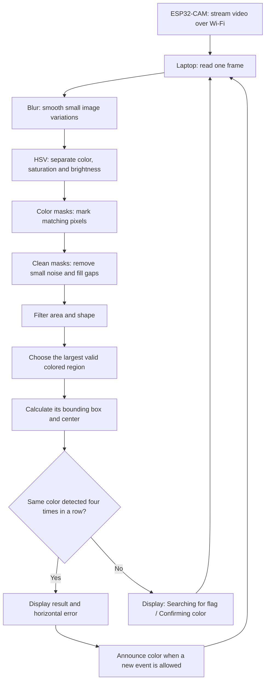
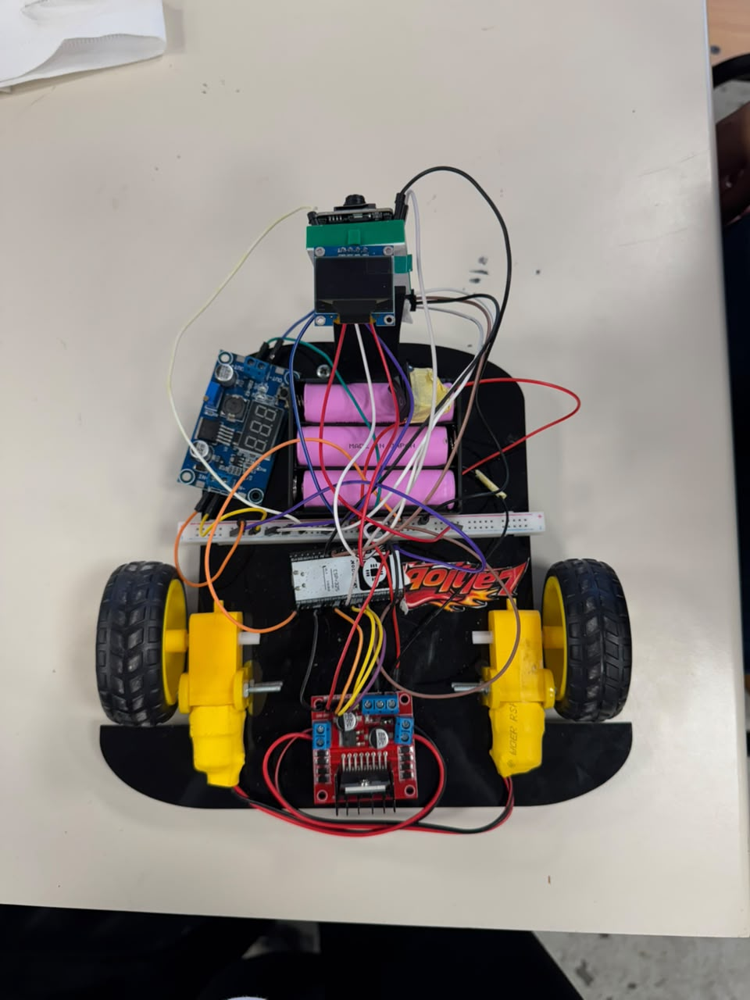
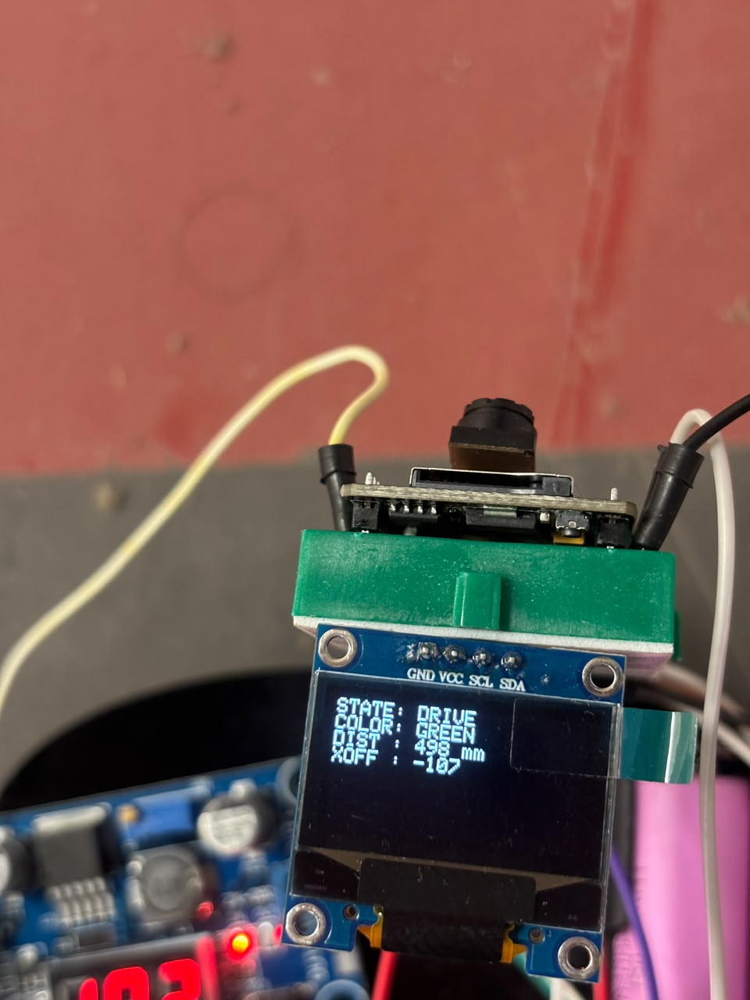
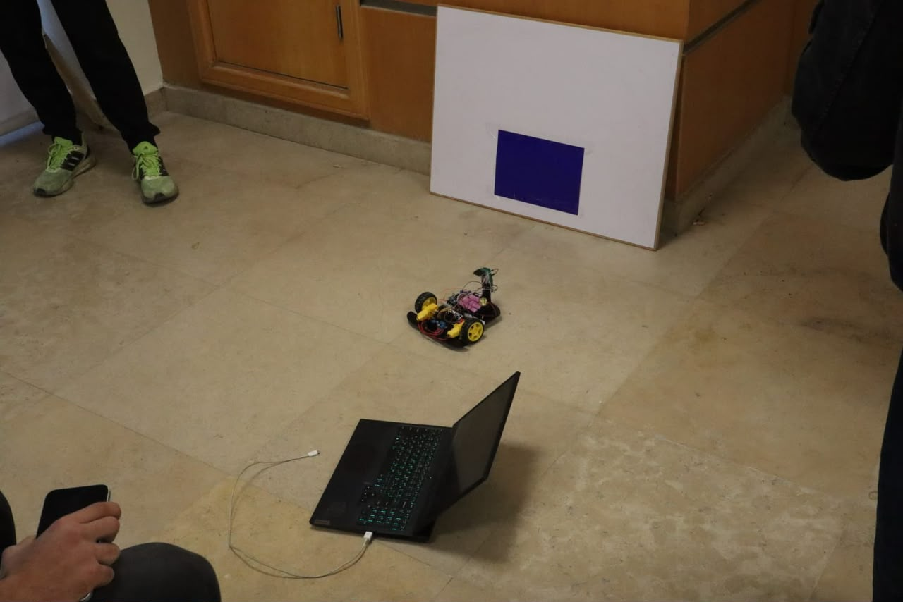
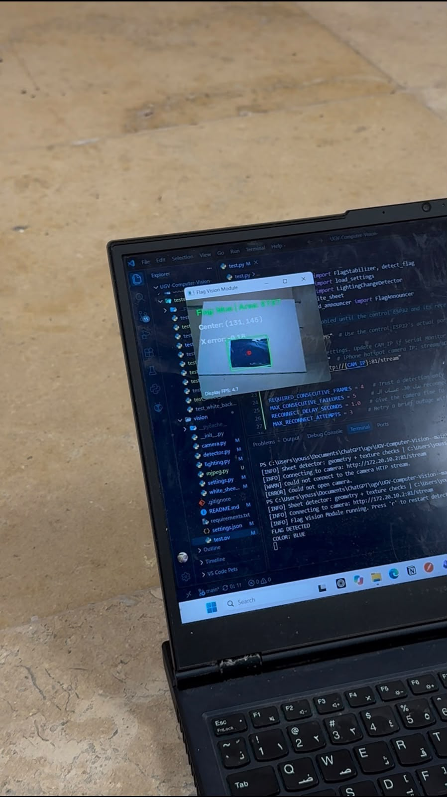
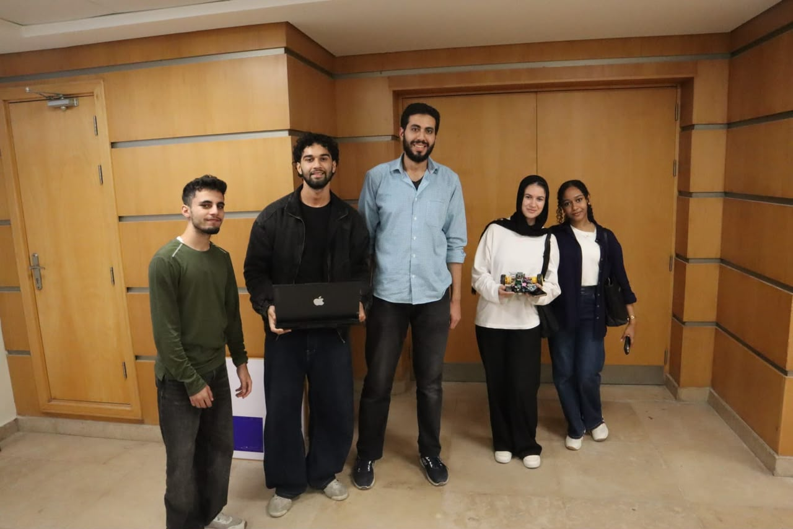

# Computer Vision System Documentation

**UGV Project - Colored Flag Detection, Identification, and Frame Stabilization**

## 1. Introduction

This project uses an ESP32-CAM and OpenCV to find a colored flag and report its color and position in the image.

The **ESP32-CAM streams video over Wi-Fi**. A **Python program on the laptop** processes that video.

The vision module:

- Searches for the configured flag colors automatically.
- Removes small image noise and rejects unsuitable regions.
- Confirms the same color across four consecutive detections.
- Displays the bounding box, area, center, and horizontal position error.
- Announces the confirmed color in the terminal, with optional USB Serial output.

> Vision supplies image position. The control team uses the ultrasonic sensor to measure the required **50 cm distance**.

## 2. Approach Selection: Classical Computer Vision Instead of Model Training

We use **HSV color filtering**: a set of rules that identifies pixels matching each configured color. The program does not use a trained model.

| Reason | Benefit for this project |
| --- | --- |
| No model training | We can start without collecting a labeled training dataset. |
| Settings stored in JSON | Color ranges and filters can be changed without rewriting the detector. |
| Simple processing stages | Each stage is easy to inspect, explain, and test. |

A trained detector could help with more complicated scenes, but would require representative data, training, and hardware evaluation. Our current approach is intended for the simpler lab setup.

It recognizes **colored regions**, so a matching object can still be mistaken for the flag.

## 3. Main application

### The pipeline



**Example:** the preview shows **Searching for flag...**. A red flag in view changes the status to **Confirming red flag...**, then becomes confirmed after four consecutive detections.

### Run the application

From the repository directory:

```powershell
python -m pip install -r requirements.txt
python test.py
```

Update `CAM_IP` in `test.py` to the camera's current IP address, without a port or URL prefix. Close other browser camera streams before starting Python. Focus the preview window and press **`q`** to exit or **`r`** to restart detection.

There is no manual calibration or settings-reload shortcut. Restart Python after editing `settings.json`. The `r` key clears confirmation; it does not reload settings.

## 4. Color Detection Using HSV and cv2.inRange()

### Why HSV?

OpenCV receives color images in **BGR**: blue, green, and red channels. We convert them to **HSV**, which makes color ranges easier to describe.

| Channel | Meaning |
| --- | --- |
| Hue | Which color the pixel resembles. |
| Saturation | How strong or faded that color is. |
| Value | How bright the pixel is. |

HSV helps organize the thresholds, but lighting, shadows, exposure, and white balance can still affect detection.

### What does `cv2.inRange()` do?

```python
# Example: mark pixels inside the configured blue HSV range.
lower = np.array([100, 70, 35])
upper = np.array([129, 255, 255])
mask = cv2.inRange(hsv_frame, lower, upper)
```

The result is a **binary mask**:

- **White / 255:** the pixel matches all three HSV limits.
- **Black / 0:** the pixel does not match.

White in a mask means "selected pixel"; it does not mean the original object is white.

## 5. Configuration Using settings.json

`settings.json` stores the color profiles and processing settings.

| Setting | Current value | Purpose |
| --- | --- | --- |
| `min_flag_area_ratio` | `0.003` | Reject contours smaller than 0.3% of the image area. |
| `aspect_ratio_range` | `[0.5, 2.0]` | Accept bounding-box width / height between 0.5 and 2.0. |
| `kernel_size` | `3` | Use a 3 × 3 neighborhood for mask cleanup. |
| `blur_kernel_size` | `3` | Use a 3 × 3 Gaussian blur before color filtering. |
| `colors` | Six HSV profiles | Search red, blue, green, yellow, orange, and purple automatically. |

For a 320 × 240 image, the minimum contour area is:

```text
320 × 240 × 0.003 = 230.4 pixels²
```

This threshold scales with image resolution. It does not measure physical flag size or distance.

A smaller kernel preserves more small details but may leave more noise. A larger kernel affects larger details and may remove part of a small target.

Red uses two HSV intervals because it crosses the ends of OpenCV's standard hue scale. The masks from both intervals are combined.

**White is excluded as a flag color** because the flag is placed on a white background. The detector searches the whole frame for the configured colors.

## 6. Functions and Methods Used in the Implementation

### `build_mask(hsv_frame, color_ranges, settings)`

Creates a mask for one color:

1. Read the HSV bounds.
2. Mark matching pixels with `cv2.inRange()`.
3. Combine a second interval if configured, as for red.
4. Clean the mask with opening and closing.

| Operation | What it helps do |
| --- | --- |
| `MORPH_OPEN` | Remove small isolated white regions from the mask. |
| `MORPH_CLOSE` | Fill small black gaps and holes inside selected regions. |

### `find_largest_blob(mask, settings)`

Finds the largest region that passes the filters:

1. Find outer contours with `RETR_EXTERNAL`.
2. Reduce redundant contour points with `CHAIN_APPROX_SIMPLE`.
3. Reject contours below the minimum area.
4. Calculate each bounding box and apply the aspect-ratio limits.
5. Return the largest accepted contour's area and box, or `None`.

A **contour** is a region's boundary. A **blob** is the image region we are considering as a candidate.

### `detect_flag(frame, settings)`

Connects the image-processing stages:

```text
Blur → HSV → Color masks → Cleanup → Filter contours → Choose candidate
```

It checks every configured profile and selects the candidate with the greatest contour area. It then calculates the bounding-box center:

```python
# x and y locate the box; w and h are its width and height.
center_x = x + w // 2
center_y = y + h // 2
```

The returned dictionary contains `detected` and, when a flag is found, its color, area, box and center. Coordinates are relative to the full camera image.

### `FlagStabilizer`

Stores the current color and consecutive-detection count between frames.

| New result | Action |
| --- | --- |
| Same color as the previous detection | Increase the count. |
| Different color | Start a new count at one. |
| No detection | Clear the color and reset the count. |
| Count reaches four | Return a confirmed result. |

Four detections means **four frames, not four seconds**. Confirmation checks color consistency; it does not verify the same physical object or average its position.

### `main()`

Loads settings, opens the camera, reads frames, calls the detector and stabilizer, updates announcements, and draws the preview.

For confirmed results, it calculates horizontal position error:

```python
# Normalize the flag center relative to the image midpoint.
midpoint = (frame.shape[1] - 1) / 2.0
x_error = (cx - midpoint) / midpoint if midpoint > 0 else 0.0
```

- **Negative:** left of center.
- **Near zero:** centered.
- **Positive:** right of center.

This normalized value is displayed. UDP output uses the horizontal offset in pixels instead; the control team decides how that offset changes steering.

The announcement module suppresses repeated same-color messages. A different confirmed color or ten consecutive unconfirmed updates allows another announcement. Terminal output works by default; optional USB Serial sends `FLAG_DETECTED,RED` followed by a newline.

The current Wi-Fi output sends `DET,COLOR,xOffset,area` or `NONE` to the camera's UDP port 5005. The custom camera firmware forwards these messages to the control ESP32 over UART. Receiver behavior, display output and motor integration still need physical verification.

The camera reader keeps the latest available frame rather than a growing queue. On a lost stream, the preview clears the old detection and tries up to three reconnects after five failed reads. It waits for the previous reader to close before opening another. Camera, windows, UDP socket and optional Serial resources are closed on exit.

## 7. Problems Faced During Development

| Problem | Response and remaining work |
| --- | --- |
| Dark red target did not match the original HSV profile | Adjusted the practice red saturation/value limits. Verify all profiles with actual camera images. |
| Small details could be lost during processing | Reduced blur and morphology kernels from 5 to 3. This is a tuning choice, not a universal improvement. |
| White background could become the largest detected region | Removed white from the possible flag colors. |
| A larger colored distractor can win | The largest matching region is chosen; keep other same-colored objects out of view. |
| A single frame could produce an unstable result | Require four consecutive same-color detections. |
| Camera IP changed or video stopped | Update `CAM_IP` when the address changes; bounded reconnection handles temporary stream failures. |

Offline tests use synthetic images and simulated hardware to check all six colors at several brightness levels, preview statuses, announcements and cleanup. Robot sockets are mocked. These tests do not establish real-camera accuracy.

Run them with:

```powershell
python -m unittest discover -s tests -v
```

Lighting, distance, and full-robot performance still need recorded physical tests. No measured detection accuracy or frame-rate claim is made here.

## 8. Limitations and Cases Where the Approach May Fail

| Situation | Possible result |
| --- | --- |
| Larger objects matching a configured color | The detector may select a distractor. |
| Shadows, glare, or exposure changes | The flag may fall outside its HSV range. |
| Small or distant flag | Too few pixels or insufficient contour area. |
| Narrow, tilted, or partially hidden flag | Its bounding box may fail the aspect-ratio filter. |
| Overlapping color profiles | The same region may match multiple colors; equal-area candidates favor the earlier profile. |
| Interrupted or slow video | Confirmation may reset or take longer. |
| Different same-color objects across frames | Color-only confirmation can accept them as a consistent result. |

White flags are unsupported by the current configuration. The system detects colored regions rather than semantic flag identity. Thresholds and filters need validation in the actual lab setup.

## 9. Conclusion

The project uses a clear, configurable pipeline to turn ESP32-CAM video into a confirmed color and image position:

**Capture → Find colors → Confirm → Display and announce**

The next milestone is a complete robot run: integrate vision output with the control ESP32, verify the display, and test centering and ultrasonic-based 50 cm distance control.

## 10. Meet Lahloba 🚗

All of the code above lives inside one small, very determined robot: **Lahloba**, which means *the spicy car* 🌶️. Small body, big attitude.

**Say hi to Lahloba, our UGV!** 👋 Yes, every wire is load-bearing. No, we will not be taking questions about which one does what.



Lahloba runs on three pink batteries, two yellow wheels and an unreasonable amount of jumper wire. It has exactly one eye (an ESP32-CAM) and a tiny screen it uses to tell everyone how it's feeling. It only really cares about one thing in life: colored flags. Show it a flag and it drives straight over, stops at a polite distance, and tells you what color it saw, like a toddler who just learned colors and wants the whole room to know.

What's inside:

- **Eye:** ESP32-CAM on the green mount up front, streaming video over Wi-Fi to the laptop running this code.
- **Brain:** the laptop finds and confirms the flag, then sends `DET,COLOR,xOffset,area` messages back to the robot.
- **Muscles:** an ESP32 controller and an L298N motor driver turning the two yellow gear motors.
- **Mood screen:** an OLED display showing the current state, color, distance and horizontal offset.
- **Snacks:** three Li-ion cells and a buck converter keeping the voltage in check.

### Test day recap

**The mood screen in action:** Lahloba reports `STATE: DRIVE`, `COLOR: GREEN`, `DIST: 498 mm` and `XOFF: -107`. In other words: "I see green, it's half a meter away and a bit to my left, and I'm going."



**The real test:** Lahloba lines up with a blue flag on a white board while the laptop does the thinking from the floor.



**Meanwhile, on the laptop:** the Flag Vision Module preview boxes the blue flag in green and marks its center, and the terminal proudly announces `FLAG DETECTED` / `COLOR: BLUE`. Lahloba saw it, the code confirmed it, everyone cheered.



**The team (and Lahloba, front row, center of attention as usual):**



[Project repository](https://github.com/shrouqelshafey/UGV-Computer-Vision-)
